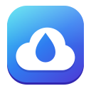

<p align="center"></p>

# CloudDrop

[](https://github.com/Dhiva-Labs/CloudDrop/actions/workflows/ci.yml)


An upload-only cloud folder for Linux and Windows, on Intel/AMD (x64) and ARM (arm64)
computers: Google Drive, OneDrive, Dropbox, Nextcloud and other WebDAV servers,
S3-compatible storage, SFTP and MEGA (plus experimental Proton Drive in source builds).
It is for people who want a folder that backs up what they drop into it and lets them
reclaim disk space safely. The engine is a Rust daemon with a command line, a GTK4/libadwaita
desktop app, a Nautilus extension and a Windows app.

**Documentation:** step-by-step guides at [learn.dhivalabs.com](https://learn.dhivalabs.com/apps/clouddrop/): [install](https://learn.dhivalabs.com/apps/clouddrop/install) · [beginner guide](https://learn.dhivalabs.com/apps/clouddrop/getting-started) · [troubleshooting](https://learn.dhivalabs.com/apps/clouddrop/faq). New to the topic? Try the [Files, backups and recovery](https://learn.dhivalabs.com/tracks/files/) learning track.

Anything you put in your CloudDrop folder (`~/CloudDrop`, or `%USERPROFILE%\CloudDrop`
on Windows) is uploaded to your cloud with the same folder structure, under a
`CloudDrop` folder (in My Drive on Google Drive, in `Apps/CloudDrop` on OneDrive and
Dropbox). Deleting a file locally **never** deletes it in the cloud: it becomes
*cloud-only*, stays listed in CloudDrop and in your file manager, and can be downloaded
back at any time. So you can free up space on your computer without losing anything —
by hand, or automatically.

- **Uploads** new and edited files.
- **Keeps your folders**: the same structure in the cloud; renames and moves are applied
  there without re-uploading.
- **Never deletes in the cloud**: a local delete makes the file cloud-only, and when a
  cloud-only file is replaced, its old content is kept.
- **Free Up Space** by hand, or **automatically** right after upload or after 7, 30 or
  90 days — with folders you mark *Always keep on this computer* left alone. Local
  copies are removed only after checking the cloud holds an identical copy (by the
  cloud's own checksum, or by downloading it again where the cloud has none).
- **Resumable**: large uploads continue where they stopped after a network drop,
  a reboot or a crash.
- **Several folders, several clouds**: upload another folder to a cloud of its own, e.g.
  `~/CloudDrop` to Google Drive and `~/Work` to a Nextcloud (*Add Another Folder…*, or
  `clouddrop connections add`).
- **Desktop app** with a setup assistant, a **Home** overview (what's happening, with
  upload speed and time left, cloud storage, space freed, recent activity), a
  **Files** browser of everything in CloudDrop (cloud-only included) with search, filters,
  multi-select and drag & drop, an **Activity** history you can filter, and **Settings**
  (including a light or dark style and an accent color).
- **Top-bar icon**: status at a glance, pause/resume, quick links, every folder listed.
- **Windows: a File Explorer cloud folder** with Explorer's own status icons,
  *Free up space* and *Always keep on this device*, and a notification-area icon.
- **Linux: Files integration**: status emblems and a column named after your cloud in
  Nautilus; right-click *Free Up Space*, *Open in Google Drive* (or your cloud),
  *Retry Upload*, *Always Keep on This Computer*, and a *Cloud-only Files* menu to
  download things back.

CloudDrop asks each cloud for as little access as it allows: on Google Drive only the
files it creates itself (`drive.file`), on OneDrive and Dropbox only its own app folder.
Files go straight between your computer and your cloud; Dhiva Labs runs no server for
CloudDrop. See the [privacy policy](PRIVACY.md).

## Engineering highlights

- **A provider-neutral upload engine.** One async (tokio) state machine in
  [`src/engine.rs`](src/engine.rs) drives every cloud through the `Remote` enum and each
  provider's `Capabilities` in [`src/remote.rs`](src/remote.rs): hash kind, whether ids are
  stable or paths, forbidden characters, case sensitivity. Eight clients plug in
  ([Google Drive](src/drive.rs), [OneDrive](src/onedrive.rs), [Dropbox](src/dropbox.rs),
  [WebDAV/Nextcloud](src/webdav.rs), [S3](src/s3.rs), [SFTP](src/sftp.rs),
  [MEGA](src/mega.rs), [Proton Drive](src/proton.rs)).
- **State in SQLite, crash-safe.** Every file's state (`pending`, `uploading`, `synced`,
  `cloud_only`, `error`), the resumable upload session, retry time and activity history live in
  one WAL-mode database with schema migrations ([`src/db.rs`](src/db.rs)); the schema and the
  rules are written down in [docs/DESIGN.md](docs/DESIGN.md). Renames and moves are detected
  by inode, including ones made while the daemon was stopped.
- **Resumable uploads and retry with backoff.** Chunked uploads keep their session in the
  database, so a failure, a restart or a reboot continues the same session. Failures retry
  with exponential backoff from 5 s up to 15 min, and never sooner than a provider's
  `Retry-After` (`backoff_ms` and `retry_delay_ms` in [`src/engine.rs`](src/engine.rs)).
  [`multi_chunk_upload_survives_errors_and_restart`](tests/e2e.rs) fails a chunk, stops the
  daemon and checks that one session carries the whole file.
- **It never deletes in the cloud, and checks before it frees space.** The `Remote`
  interface has no delete-a-file call. The one deletion in the code is S3's rename, and only
  in a bucket that keeps versions. Freeing local space re-hashes the file and compares it with the
  cloud's checksum, or downloads the cloud copy and compares SHA-256 where there is none
  ([`src/actions.rs`](src/actions.rs)); [`free_refuses_unverified_copies`](tests/e2e.rs) and
  `without_hashes_freeing_downloads_and_compares_first` cover it.
- **Tested against fake clouds.** [`tests/e2e.rs`](tests/e2e.rs) runs 44 end-to-end
  scenarios (rename during upload, expired and revoked tokens, lost database, pause and
  resume) against a mock Google Drive, and the other clouds have their own mock servers in
  [`tests/common`](tests/common) (S3, Dropbox, OneDrive, WebDAV, MEGA, Proton) and an
  OpenSSH-backed SFTP test that skips where `sshd` is not installed.
- **Packaged for several platforms.** CI builds and tests on x64 and arm64, Linux and
  Windows, and builds the Debian package, snap, rpm and Arch packages
  ([`.github/workflows/ci.yml`](.github/workflows/ci.yml)).

## Status and limits

CloudDrop is young: the first release was 0.1.0, the latest is 0.3.1, and there is no
security audit. Only Google Drive, OneDrive and Dropbox have been tried against real
accounts. WebDAV/Nextcloud, S3, SFTP and MEGA are labelled preview below and are tested
against fake servers (SFTP against a real OpenSSH server), not real services. Proton Drive is
experimental and builds from source only. It is upload-only: there is no download-sync of
changes made elsewhere in the cloud, and no AppImage or Flatpak (see
[Install on Linux](#install-on-linux)).

## Clouds

| Cloud | Sign-in | Status |
| --- | --- | --- |
| **Google Drive** | browser | since 0.1.0 |
| **OneDrive** (personal) | browser | since 0.3.1; ready to use in the snap and PPA, tried on a real account |
| **Dropbox** | browser | since 0.3.1; ready to use in the snap and PPA, tried on a real account |
| **Nextcloud**, other **WebDAV** | app password | preview: tested against a fake server |
| **S3-compatible** (AWS, Backblaze B2, Wasabi, R2, MinIO, Garage) | access key | preview: tested against a fake S3 |
| **SFTP** | SSH key or password | preview: tested against a real OpenSSH |
| **MEGA** | email and password | preview: tested against a fake MEGA |
| **Proton Drive** | Proton's own CLI | experimental: builds from source only |

OneDrive work or school accounts sign in through the same button, but an organisation
may need its admin to approve CloudDrop first. `clouddrop providers` lists the clouds a
build offers. [docs/PROVIDERS.md](docs/PROVIDERS.md) has how each one works, how it was
tested and what's still to do.

## Install on Windows (10 version 1809 or later, 11)

- **[Microsoft Store](https://apps.microsoft.com/detail/9P8CJ02X8KD8)** (free; signed,
  updated by the Store, and works out of the box). The Store still has 0.2.0, which
  uploads to Google Drive only; the other clouds and several folders reach it with the
  next Store update.
- **Zip**: download `CloudDrop-…-windows-x64.zip` from
  [Releases](https://github.com/Dhiva-Labs/CloudDrop/releases/latest) (or
  `CloudDrop-…-windows-arm64.zip` on a Windows on ARM PC, such as a Snapdragon X
  laptop), extract it and double-click `install.cmd`. It installs for your user only
  (no administrator rights) and adds CloudDrop to the Start menu and to *Settings ›
  Apps* for uninstalling. This build is unsigned, so Windows *Smart App Control* may
  block it, and it has no Google, OneDrive or Dropbox client built in: for Google
  Drive the setup assistant shows how to create your own (as in
  [From source](#from-source)), and OneDrive and Dropbox need a client id of your own
  ([docs/PROVIDERS.md](docs/PROVIDERS.md)). Nextcloud, WebDAV, S3, SFTP and MEGA need
  nothing extra.

Both zips are built natively for their processor (the arm64 one is not x64 code
running under emulation).

The CloudDrop folder appears in File Explorer's navigation pane. Uploaded files get
a green check; right-click → *Free up space* keeps a file listed with a cloud icon
and downloads it again when you open it; *Always keep on this device* downloads it
back and keeps it. See [docs/WINDOWS.md](docs/WINDOWS.md) for how it works.

## Install on Linux

CloudDrop is built and tested on x86-64 (amd64) and ARM (arm64, also called aarch64)
computers. A build from source works on both.

Ubuntu 26.04, from the PPA (includes the Files integration):

```bash
sudo add-apt-repository ppa:dhiva-labs/apps
sudo apt install clouddrop
```

Any distribution, from the [Snap Store](https://snapcraft.io/clouddrop) (everything
except the Files integration, which a snap can't add):

```bash
sudo snap install clouddrop
```

CI builds the snap and the PPA's Debian package for both amd64 and arm64. The arm64
ones reach the Snap Store and the PPA once they are uploaded there; until then, an
arm64 computer can build from source.

Fedora, RHEL, openSUSE and Arch (x86-64 and arm64), from
[Releases](https://github.com/Dhiva-Labs/CloudDrop/releases) from the next release on,
repackaged from the same build as the Debian package (which is attached there too, as
`clouddrop_<version>_<amd64|arm64>.deb`):

| | x86-64 | arm64 (aarch64) |
| --- | --- | --- |
| Fedora / RHEL / openSUSE | `clouddrop-<version>-1.x86_64.rpm` | `clouddrop-<version>-1.aarch64.rpm` |
| Arch / Manjaro / EndeavourOS | `clouddrop-<version>-1-x86_64.pkg.tar.zst` | `clouddrop-<version>-1-aarch64.pkg.tar.zst` |
| AUR recipe (`clouddrop-bin`) | `clouddrop-bin-<version>-aur.tar.gz` | (same file) |

```bash
sudo dnf install ./clouddrop-<version>-1.x86_64.rpm                              # Fedora, RHEL
sudo zypper install --allow-unsigned-rpm ./clouddrop-<version>-1.x86_64.rpm      # openSUSE
sudo pacman -U ./clouddrop-<version>-1-x86_64.pkg.tar.zst                         # Arch
```

They install what the Debian package does: the background service as a systemd user
unit, the desktop app, and the Files extension (which needs `nautilus-python` on
Fedora, `python3-nautilus` on openSUSE or `python-nautilus` on Arch; the packages
recommend it, and the top-bar icon on GNOME needs the AppIndicator extension). They
need glibc 2.39, GTK 4.12 and libadwaita 1.6 or newer: Fedora 41+, openSUSE
Tumbleweed and current Arch, not RHEL 9 or openSUSE Leap 15. The `.rpm` is not
signed (hence `--allow-unsigned-rpm`). `clouddrop-bin` on the AUR needs publishing
first; until then, `makepkg -si` in the unpacked `clouddrop-bin-<version>-aur.tar.gz`.
CI installs the `.rpm` on Fedora and openSUSE Tumbleweed and the Arch package on Arch
Linux (x86-64; Arch has no official arm64 image, so the arm64 package gets a static
check), and starts the command line and the desktop app there.

Like the Windows zips, these are built in CI without CloudDrop's own Google, OneDrive
and Dropbox clients: for those clouds, set up a client of your own as described in
[From source](#from-source) and [docs/PROVIDERS.md](docs/PROVIDERS.md). Nextcloud,
WebDAV, S3, SFTP and MEGA need nothing extra.

There is no AppImage or Flatpak: the background service is a systemd user unit that
the desktop app turns on with `systemctl --user`. Neither format can install that unit
(or the Files extension), and the app has no other way to start the service outside the
snap, so nothing would upload. On a distribution without a package here, use the snap.

Open **CloudDrop** from your app grid, choose your cloud and sign in, and you're
done: the assistant creates `~/CloudDrop`, starts the background service, adds the
folder to the Files sidebar, turns on the top-bar icon, and can restart Files so
the status icons appear.

### From source

Needs Rust, `pkg-config`, `libgtk-4-dev`, `libadwaita-1-dev` (GTK 4.12+, libadwaita
1.5+) and, for the Files integration, `python3-nautilus`.

```bash
./install.sh            # builds and installs into ~/.local for your user
```

Source builds don't include CloudDrop's own Google, OneDrive and Dropbox clients.
`./install.sh` also turns on the experimental Proton Drive. For Google Drive, the
assistant walks you through creating your own free client first (about five minutes,
once):

1. Create a project at <https://console.cloud.google.com/projectcreate>.
2. Enable the **Google Drive API** for it.
3. **Google Auth Platform → Get started**: app name, your email, audience **External**.
4. **Data Access → Add or remove scopes** → add `https://www.googleapis.com/auth/drive.file`.
5. **Audience → Publish app** (in *Testing*, Google expires sign-ins after 7 days;
   `drive.file` is non-sensitive, so no Google review is needed).
6. **Clients → Create client** → **Desktop app** → **Download JSON**, and choose
   that file in the assistant.

For OneDrive and Dropbox, register an app of your own as described in
[docs/PROVIDERS.md](docs/PROVIDERS.md) and put its id in the config (`[onedrive]
client_id`, `[dropbox] app_key`).

To build with clients compiled in (as the PPA, snap and Store builds do), save them
before building with `packaging/set-oauth-client.sh client_secret_….json` and
`packaging/set-oauth-client.sh --onedrive CLIENT_ID --dropbox APP_KEY`; the file they
write is gitignored.

From a terminal instead of the assistant:

```bash
clouddrop setup --client-json ~/Downloads/client_secret_….json   # Google Drive
clouddrop setup --provider dropbox     # or another cloud: an id from `clouddrop providers`
clouddrop service enable               # start at sign-in
```

## Using it

Copy or move files into `~/CloudDrop` (or drag them onto CloudDrop's Files tab).

- **Home** shows what's happening (while uploading: progress, speed and time left), how
  much of your cloud storage is used, how much space CloudDrop has freed here, the latest
  activity, and big buttons for *Open Folder*, *Add Files…*, *Free Up Space…* and *Pause*.
  The status is also in the window's header (Linux) or navigation pane (Windows), whatever
  the screen.
- **Files** browses everything in CloudDrop, including cloud-only files. Select items
  to **Download**, **Free Up Space**, **Open in Google Drive** (or your cloud), **Show in
  Files** or **Retry**; pin a folder to *Always keep on this computer*. Filter by *On this
  computer*, *Cloud-only*, *Uploading* or *Failed*.
- **Activity** lists what was uploaded, moved, freed, downloaded back or failed; show just
  uploads, freed space, downloads or problems.
- **Settings**: light or dark style and an accent color, automatic space saving, kept
  folders, account, upload speed, notifications, ignored files, top-bar icon.

*Add Another Folder…* uploads another folder to a cloud of its own; the window then
switches between your folders, and *Remove This Folder…* stops uploading one without
deleting anything. Closing the window keeps CloudDrop in the top bar.

In Files:

| Emblem | Meaning |
| --- | --- |
| green check | uploaded |
| sync arrows | waiting or uploading |
| red `!` | upload failed (right-click → *Retry Upload*) |

From a terminal:

```bash
clouddrop status
clouddrop free ~/CloudDrop/Videos
clouddrop ls-cloud ~/CloudDrop/Videos
clouddrop restore ~/CloudDrop/Videos/holiday.mp4
clouddrop auto-free 30            # never | now | number of days
clouddrop keep ~/CloudDrop/Work   # unkeep to undo
clouddrop pause                   # resume to continue
clouddrop connections             # every folder and its cloud; add / remove
clouddrop status --all
```

Every command takes `--connection NAME`; without it, it works on the folder that holds
the path you give it.

## How changes are handled

| You do locally | In the cloud |
| --- | --- |
| add a file or folder | uploaded into the matching folder |
| edit a file | the same cloud file is updated |
| rename or move inside `~/CloudDrop` | renamed or moved (no re-upload) |
| delete a file or folder | **kept**; shown as cloud-only |
| put a different file where a cloud-only one was | updated; the old content is kept (see below) |
| rename a file over another uploaded file | the overwritten one stays in the cloud as `name (2).ext` |
| move something out of `~/CloudDrop` | kept in the cloud, cloud-only |

Old content is kept as a version Google Drive keeps forever, or, on clouds that can't
pin a version, as a copy next to the file named `name (replaced 2026-10-21).ext`. On
S3-compatible storage, which has no folders, a rename is a copy, and the old name is
deleted only when the bucket keeps versions.

A file you download back stays on your computer until you free it again or edit it
(automatic space saving won't immediately remove it). Temporary files (`*.part`,
`*.crdownload`, `*.tmp`, `*.swp`, `*~`, office lock files, …) are ignored.
Symlinks are skipped.

## Configuration

Everything is in **Settings**; the file is `~/.config/clouddrop/config.toml`
(`~/snap/clouddrop/common/config.toml` in the snap):

```toml
sync_dir = "/home/you/CloudDrop"
drive_folder = "CloudDrop"     # top folder in the cloud (in My Drive on Google Drive)
parallel_uploads = 2
settle_secs = 2                # wait after the last change before uploading
notifications = true
auto_free_days = 30            # absent = never, 0 = right after upload
keep_local = ["Work"]          # folders never freed automatically
theme = "dark"                 # absent = follow the system; or "light"
accent = "teal"                # absent = the system's; blue, teal, green, purple, pink, orange
ignore = [".goutputstream-*", "*.part", "*.crdownload", "*.tmp", "~$*", ".~lock.*#", "*.swp", "*~", ".Trash-*"]
```

The cloud's own settings are in a section named after it (`[nextcloud]`, `[s3]`, …);
passwords and keys are kept apart, in `credentials.json`, never in the config. Each
other folder has a config of its own in `connections/<name>/config.toml` beside this
one.

After editing by hand: `clouddrop service stop` and `clouddrop service start`
(`systemctl --user restart clouddrop` also works outside the snap). State lives in
`~/.local/share/clouddrop/` (`~/snap/clouddrop/common/data/` in the snap): `state.db`,
and the sign-in files, readable only by you.

## Troubleshooting

- **Logs**: `journalctl --user -u clouddrop -f` (PPA and source installs).
- **"Sign in again"**: click *Sign In* in CloudDrop (or `clouddrop login`); uploads
  resume by themselves.
- **The CloudDrop folder was deleted in the cloud**: restore it from the cloud's trash, or
  run `clouddrop reset-cloud --yes` to upload everything again into a new folder.
- **No emblems or menu items in Files**: install `python3-nautilus` and restart Files
  (Settings → *Restart Files*, or `nautilus -q`).
- **No top-bar icon**: it needs the AppIndicator extension (built into Ubuntu).

## Uninstall

`sudo apt remove clouddrop`, `sudo snap remove clouddrop`, or `./install.sh
--uninstall` for a source install. Your files, settings and cloud copies are kept. If
you no longer want CloudDrop to reach your cloud, revoke its access: Google at
<https://myaccount.google.com/permissions>, Microsoft at
<https://account.live.com/consent/Manage>, Dropbox at
<https://www.dropbox.com/account/connected_apps>.

## Development

CI (`.github/workflows/ci.yml`) runs the Linux tests, the Debian package and the snap on
amd64 and arm64, and the Windows tests, the cloud-folder test, the app and the Windows
packages on x64 and arm64, on native runners of each.

```bash
cargo test --workspace                                 # unit + end-to-end tests against fakes of every cloud
python3 -m unittest discover -s nautilus/tests -v      # Files extension
cargo run --example mock_drive -- 127.0.0.1:8099      # fake Google Drive for trying the app offline
```

See [docs/DESIGN.md](docs/DESIGN.md) for the state model and rules,
[docs/PROVIDERS.md](docs/PROVIDERS.md) for the clouds (how each works and is tested, and
how to add one), and [packaging/vendor/README](packaging/vendor/README) for the offline
PPA build.

The logo's sources are the SVGs in `data/icons`; `python3 packaging/make-icons.py`
renders every Windows and Store image from them.

## Sponsors

Dhiva Labs is an independent, self-funded lab. [Sponsorships](https://github.com/sponsors/Dhiva-Labs) help bring this project and the rest of Dhiva Labs to every platform, iPhone and Mac included.

[](https://github.com/sponsors/Dhiva-Labs)

Monthly sponsors at $10 and up are listed here:

<!-- sponsors -->
*Be the first: [sponsor Dhiva Labs](https://github.com/sponsors/Dhiva-Labs).*
<!-- sponsors -->

## License

MIT — see [LICENSE](LICENSE).
