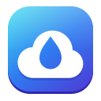

<p align="center"></p>

# CloudDrop

[](https://github.com/Dhiva-Labs/CloudDrop/actions/workflows/ci.yml)


An upload-only Google Drive folder for Linux and Windows, on Intel/AMD (x64) and ARM (arm64) computers.

> **New, in preview:** OneDrive, Dropbox, WebDAV, Nextcloud, S3-compatible storage, SFTP and MEGA
> as well as Google Drive, and Proton Drive (experimental, through Proton's CLI) in builds from
> source, and several folders at once, each to a cloud of its own (*Add Another Folder…*,
> `clouddrop connections add`); see [docs/PROVIDERS.md](docs/PROVIDERS.md) for what's tested and
> what's still to come. The rest of this page describes one folder on Google Drive.

Anything you put in your CloudDrop folder (`~/CloudDrop`, or `%USERPROFILE%\CloudDrop`
on Windows) is uploaded to Google Drive with the same
folder structure, under a `CloudDrop` folder in My Drive. Deleting a file
locally **never** deletes it from Drive: it becomes *cloud-only*, stays listed in
CloudDrop and in your file manager, and can be downloaded back at any time. So you can free up
space on your computer without losing anything — by hand, or automatically.

- **Uploads** new and edited files; edits become new versions of the same Drive file.
- **Keeps your folders**: the same structure in Drive; renames and moves are applied
  there without re-uploading.
- **Never deletes in Drive**: a local delete makes the file cloud-only.
- **Free Up Space** by hand, or **automatically** right after upload or after 7, 30 or
  90 days — with folders you mark *Always keep on this computer* left alone. Local
  copies are removed only after checking Google Drive holds an identical copy.
- **Resumable**: large uploads continue where they stopped after a network drop,
  a reboot or a crash.
- **Desktop app** with a setup assistant, a **Home** overview (what's happening, with
  upload speed and time left, Google Drive storage, space freed, recent activity), a
  **Files** browser of everything in CloudDrop (cloud-only included) with search, filters,
  multi-select and drag & drop, an **Activity** history you can filter, and **Settings**.
- **Top-bar icon**: status at a glance, pause/resume, quick links.
- **Windows: a File Explorer cloud folder** with Explorer's own status icons,
  *Free up space* and *Always keep on this device*, and a notification-area icon.
- **Linux: Files integration**: status emblems and a "Google Drive" column in Nautilus;
  right-click *Free Up Space*, *Open in Google Drive*, *Retry Upload*,
  *Always Keep on This Computer*, and a *Cloud-only Files* menu to download things back.

CloudDrop only asks Google for access to the files it creates itself
(`drive.file`) — it cannot see anything else in your Drive. Files go straight
between your computer and Google; see the [privacy policy](PRIVACY.md).

## Install on Windows (10 version 1809 or later, 11)

- **[Microsoft Store](https://apps.microsoft.com/detail/9P8CJ02X8KD8)** (free; signed,
  updated by the Store, and works out of the box).
- **Zip**: download `CloudDrop-…-windows-x64.zip` from
  [Releases](https://github.com/Dhiva-Labs/CloudDrop/releases/latest) (or
  `CloudDrop-…-windows-arm64.zip` on a Windows on ARM PC, such as a Snapdragon X
  laptop), extract it and double-click `install.cmd`. It installs for your user only
  (no administrator rights) and adds CloudDrop to the Start menu and to *Settings ›
  Apps* for uninstalling. This build is unsigned, so Windows *Smart App Control* may
  block it, and it has no Google client built in: the setup assistant shows how to
  create your own (as in [From source](#from-source)).

Both zips are built natively for their processor (the arm64 one is not x64 code
running under emulation).

The CloudDrop folder appears in File Explorer's navigation pane. Uploaded files get
a green check; right-click → *Free up space* keeps a file listed with a cloud icon
and downloads it again when you open it; *Always keep on this device* downloads it
back and keeps it. See [docs/WINDOWS.md](docs/WINDOWS.md) for how it works.

## Install on Linux

CloudDrop is built and tested on x86-64 (amd64) and ARM (arm64, also called aarch64)
computers. A build from source works on both.

Ubuntu 26.04, from the PPA (includes the Files integration):

```bash
sudo add-apt-repository ppa:dhiva-labs/apps
sudo apt install clouddrop
```

Any distribution, from the [Snap Store](https://snapcraft.io/clouddrop) (everything
except the Files integration, which a snap can't add):

```bash
sudo snap install clouddrop
```

CI builds the snap and the PPA's Debian package for both amd64 and arm64. The arm64
ones reach the Snap Store and the PPA once they are uploaded there; until then, an
arm64 computer can build from source.

Open **CloudDrop** from your app grid, click **Sign In with Google**, and you're
done: the assistant creates `~/CloudDrop`, starts the background service, adds the
folder to the Files sidebar, turns on the top-bar icon, and can restart Files so
the status icons appear.

### From source

Needs Rust, `pkg-config`, `libgtk-4-dev`, `libadwaita-1-dev` (GTK 4.12+, libadwaita
1.6+) and, for the Files integration, `python3-nautilus`.

```bash
./install.sh            # builds and installs into ~/.local for your user
```

Source builds don't include the CloudDrop Google client, so the assistant walks you
through creating your own free one first (about five minutes, once):

1. Create a project at <https://console.cloud.google.com/projectcreate>.
2. Enable the **Google Drive API** for it.
3. **Google Auth Platform → Get started**: app name, your email, audience **External**.
4. **Data Access → Add or remove scopes** → add `https://www.googleapis.com/auth/drive.file`.
5. **Audience → Publish app** (in *Testing*, Google expires sign-ins after 7 days;
   `drive.file` is non-sensitive, so no Google review is needed).
6. **Clients → Create client** → **Desktop app** → **Download JSON**, and choose
   that file in the assistant.

To build with a client compiled in (as the PPA does), save it with
`packaging/set-oauth-client.sh client_secret_….json` before building; the file is
gitignored.

From a terminal instead of the assistant:

```bash
clouddrop setup --client-json ~/Downloads/client_secret_….json
systemctl --user enable --now clouddrop
```

## Using it

Copy or move files into `~/CloudDrop` (or drag them onto CloudDrop's Files tab).

- **Home** shows what's happening (while uploading: progress, speed and time left), how
  much of your Google storage is used, how much space CloudDrop has freed here, the latest
  activity, and big buttons for *Open Folder*, *Add Files…*, *Free Up Space…* and *Pause*.
  The status is also in the window's header (Linux) or navigation pane (Windows), whatever
  the screen.
- **Files** browses everything in CloudDrop, including cloud-only files. Select items
  to **Download**, **Free Up Space**, **Open in Google Drive**, **Show in Files** or
  **Retry**; pin a folder to *Always keep on this computer*. Filter by *On this
  computer*, *Cloud-only*, *Uploading* or *Failed*.
- **Activity** lists what was uploaded, moved, freed, downloaded back or failed; show just
  uploads, freed space, downloads or problems.
- **Settings**: light or dark style and an accent color, automatic space saving, kept
  folders, Google account, upload speed, notifications, ignored files, top-bar icon.

Closing the window keeps CloudDrop in the top bar.

In Files:

| Emblem | Meaning |
| --- | --- |
| green check | uploaded |
| sync arrows | waiting or uploading |
| red `!` | upload failed (right-click → *Retry Upload*) |

From a terminal:

```bash
clouddrop status
clouddrop free ~/CloudDrop/Videos
clouddrop ls-cloud ~/CloudDrop/Videos
clouddrop restore ~/CloudDrop/Videos/holiday.mp4
clouddrop auto-free 30            # never | now | number of days
clouddrop keep ~/CloudDrop/Work   # unkeep to undo
clouddrop pause                   # resume to continue
```

## How changes are handled

| You do locally | Google Drive |
| --- | --- |
| add a file or folder | uploaded into the matching folder |
| edit a file | new version of the same file |
| rename or move inside `~/CloudDrop` | renamed or moved (no re-upload) |
| delete a file or folder | **kept**; shown as cloud-only |
| put a different file where a cloud-only one was | new version; the old version is kept forever |
| rename a file over another uploaded file | the overwritten one stays in Drive as `name (2).ext` |
| move something out of `~/CloudDrop` | kept in Drive, cloud-only |

A file you download back stays on your computer until you free it again or edit it
(automatic space saving won't immediately remove it). Temporary files (`*.part`,
`*.crdownload`, `*.tmp`, `*.swp`, `*~`, office lock files, …) are ignored.
Symlinks are skipped.

## Configuration

Everything is in **Settings**; the file is `~/.config/clouddrop/config.toml`:

```toml
sync_dir = "/home/you/CloudDrop"
drive_folder = "CloudDrop"     # top folder in My Drive
parallel_uploads = 2
settle_secs = 2                # wait after the last change before uploading
notifications = true
auto_free_days = 30            # absent = never, 0 = right after upload
keep_local = ["Work"]          # folders never freed automatically
theme = "dark"                 # absent = follow the system; or "light"
accent = "teal"                # absent = the system's; blue, teal, green, purple, pink, orange
ignore = [".goutputstream-*", "*.part", "*.crdownload", "*.tmp", "~$*", ".~lock.*#", "*.swp", "*~", ".Trash-*"]
```

After editing by hand: `systemctl --user restart clouddrop`. State lives in
`~/.local/share/clouddrop/` (`state.db`, and `token.json` readable only by you).

## Troubleshooting

- **Logs**: `journalctl --user -u clouddrop -f`.
- **"Sign in again"**: click *Sign In* in CloudDrop (or `clouddrop login`); uploads
  resume by themselves.
- **The CloudDrop folder was deleted in Drive**: restore it from Drive's trash, or
  run `clouddrop reset-cloud --yes` to upload everything again into a new folder.
- **No emblems or menu items in Files**: install `python3-nautilus` and restart Files
  (Settings → *Restart Files*, or `nautilus -q`).
- **No top-bar icon**: it needs the AppIndicator extension (built into Ubuntu).

## Uninstall

`sudo apt remove clouddrop` (or `./install.sh --uninstall` for a source install).
Your files, settings and Drive copies are kept. Revoke access at
<https://myaccount.google.com/permissions> if you no longer want CloudDrop to reach
your Drive.

## Development

CI (`.github/workflows/ci.yml`) runs the Linux tests, the Debian package and the snap on
amd64 and arm64, and the Windows tests, the cloud-folder test, the app and the Windows
packages on x64 and arm64, on native runners of each.

```bash
cargo test --workspace                                 # unit + end-to-end tests against a fake Drive
python3 -m unittest discover -s nautilus/tests -v      # Files extension
cargo run --example mock_drive -- 127.0.0.1:8099      # fake Google Drive for trying the app offline
```

See [docs/DESIGN.md](docs/DESIGN.md) for the state model and rules,
[docs/PROVIDERS.md](docs/PROVIDERS.md) for the plan to support more clouds, and
[packaging/vendor/README](packaging/vendor/README) for the offline PPA build.

The logo's sources are the SVGs in `data/icons`; `python3 packaging/make-icons.py`
renders every Windows and Store image from them.

## License

MIT — see [LICENSE](LICENSE).
